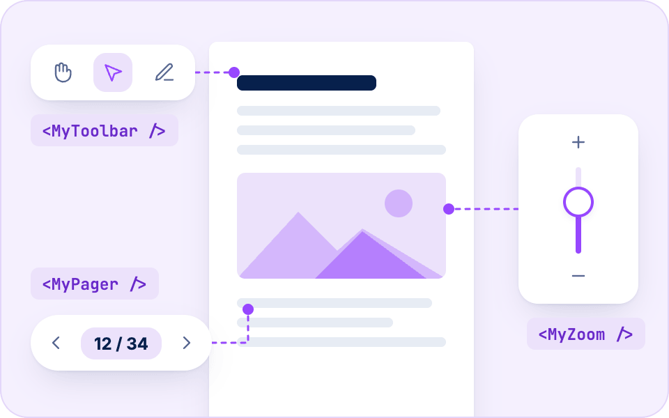
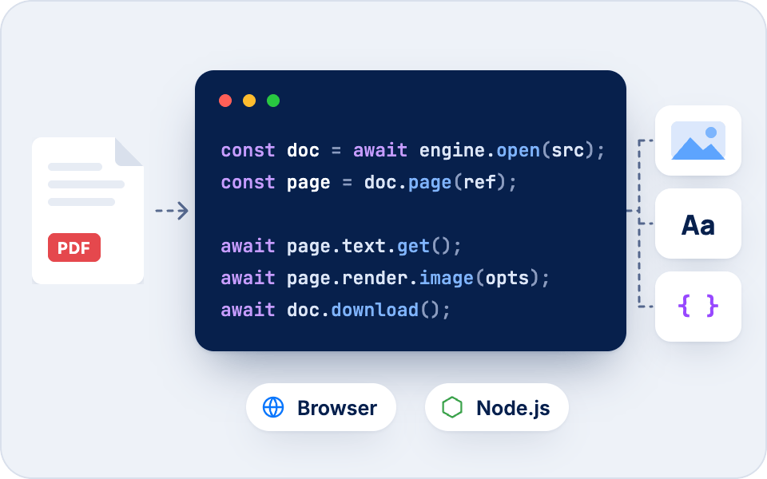
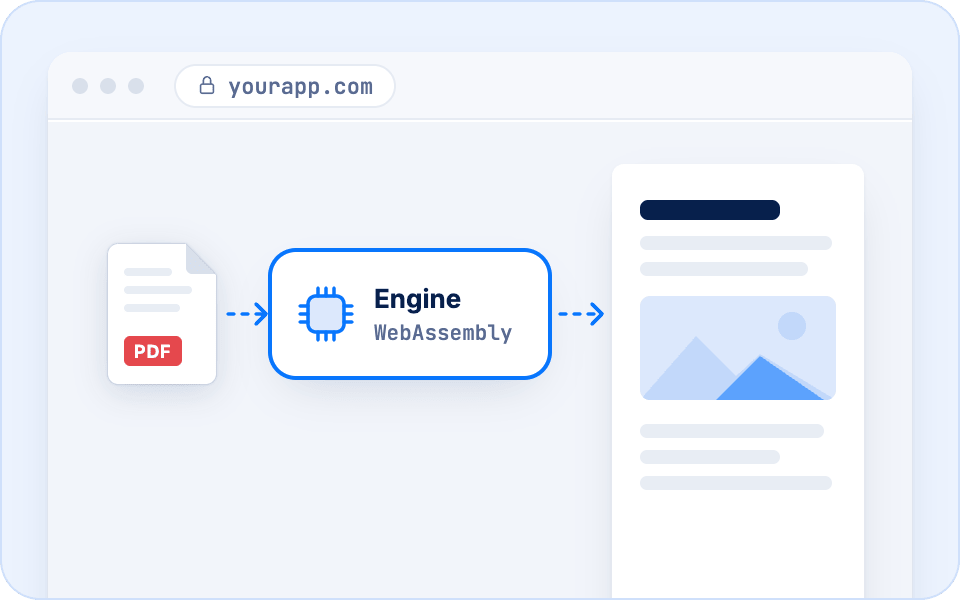
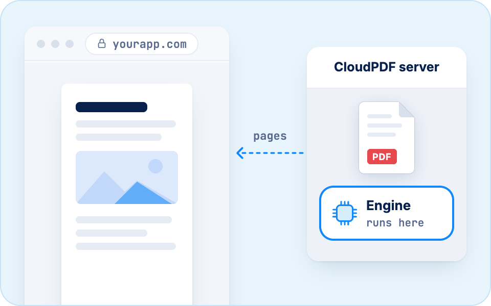
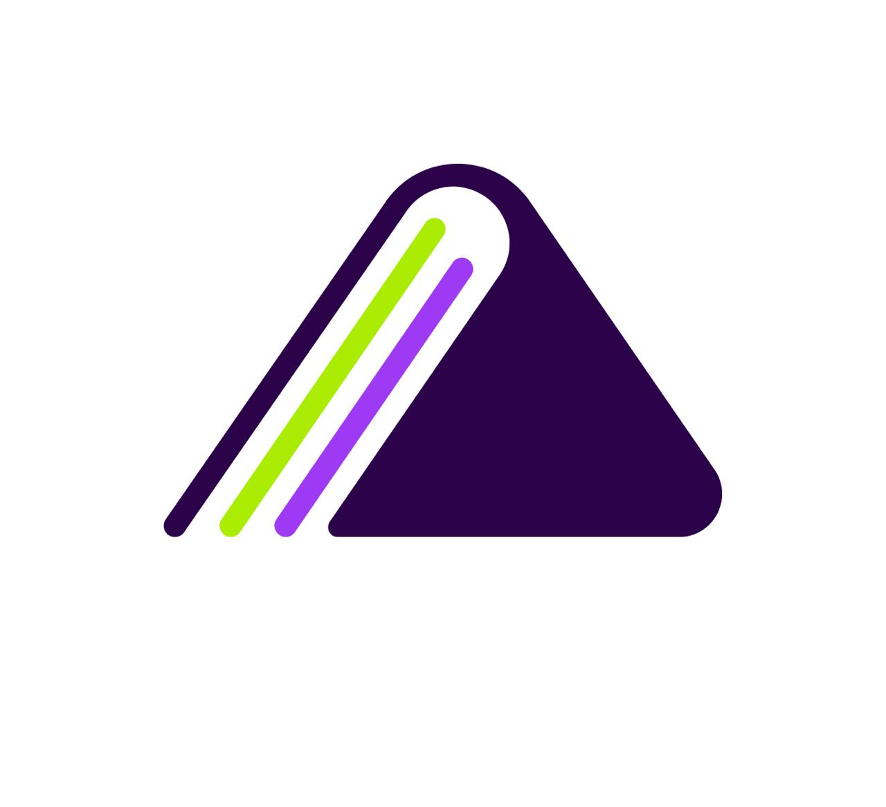
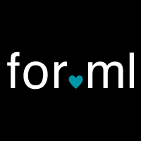

<div align="center">
  <a href="https://www.embedpdf.com">
    
  </a>

  <h1>EmbedPDF</h1>

  <!-- Badges -->

<a href="https://github.com/embedpdf/embed-pdf-viewer/blob/main/LICENSE"></a>
<a href="https://www.npmjs.com/package/@embedpdf/viewer"></a>
<a href="https://www.embedpdf.com/demo"></a>
<a href="https://discord.gg/mHHABmmuVU"></a>

</div>

# Open-source PDF viewer for JavaScript

EmbedPDF is a PDF viewer you add to any web app, in plain HTML, React, Vue, Svelte or Angular.
People read, annotate, fill in, sign and redact PDFs right in the browser, on a PDF engine built
on PDFium that runs as WebAssembly. Apache-2.0 licensed.

- **Docs:** [www.embedpdf.com/docs](https://www.embedpdf.com/docs)
- **Live demo:** [www.embedpdf.com/demo](https://www.embedpdf.com/demo)

## Three ways to use it

<!--
  Each card is its own table floated left, so the cards sit side by side on
  wide screens and stack on phones. Between cards, a transparent 1px image
  floated left makes the gap: GitHub pads img[align=left] 20px on the right. The
  image width (230) sets the card width: keep every text line shorter than it,
  or the three cards no longer fit in one row at 1280px. The empty <p> after
  each link keeps space under it: GitHub drops the margin of a cell's last
  element.
-->

<table align="left">
  <tr>
    <td valign="top">
      <a href="https://www.embedpdf.com/docs/viewer/vanilla/quick-start">
        <picture>
          <source media="(prefers-color-scheme: dark)" srcset=".github/assets/readme/viewer-dark.png">
          
        </picture>
      </a>
      <h3>Viewer</h3>
      <p>A complete viewer, toolbar<br>and panels included: one tag,<br>made yours with plain config.</p>
      <p><a href="https://www.embedpdf.com/docs/viewer/vanilla/quick-start"><b>Viewer docs →</b></a></p>
      <p></p>
    </td>
  </tr>
</table>


<table align="left">
  <tr>
    <td valign="top">
      <a href="https://www.embedpdf.com/docs/headless/react">
        <picture>
          <source media="(prefers-color-scheme: dark)" srcset=".github/assets/readme/headless-dark.png">
          
        </picture>
      </a>
      <h3>Headless components</h3>
      <p>The same plugins without the<br>UI, to build your own viewer in<br>React, Vue, Svelte or Angular.</p>
      <p><a href="https://www.embedpdf.com/docs/headless/react"><b>Headless docs →</b></a></p>
      <p></p>
    </td>
  </tr>
</table>


<table align="left">
  <tr>
    <td valign="top">
      <a href="https://www.embedpdf.com/docs/engine/quick-start">
        <picture>
          <source media="(prefers-color-scheme: dark)" srcset=".github/assets/readme/engine-dark.png">
          
        </picture>
      </a>
      <h3>Engine</h3>
      <p>Open, read, change and render<br>PDFs from your own code, in<br>the browser or in Node.</p>
      <p><a href="https://www.embedpdf.com/docs/engine/quick-start"><b>Engine docs →</b></a></p>
      <p></p>
    </td>
  </tr>
</table>

<br clear="all">

## Quick start

In plain HTML, from a CDN:

```html
<embedpdf-viewer src="https://www.embedpdf.com/pdfs/welcome.pdf" style="height: 100vh"></embedpdf-viewer>

<script
  type="module"
  src="https://cdn.jsdelivr.net/npm/@embedpdf/viewer@3/dist/embedpdf.js"
></script>
```

In React:

```sh
npm install @embedpdf/viewer-react
```

```tsx
import { PDFViewer } from '@embedpdf/viewer-react';

export function App() {
  return <PDFViewer src="https://www.embedpdf.com/pdfs/welcome.pdf" style={{ height: '100vh' }} />;
}
```

Vue, Svelte and Angular work the same way, with `@embedpdf/viewer-vue`, `@embedpdf/viewer-svelte`
and `@embedpdf/viewer-angular`. The [Quick start](https://www.embedpdf.com/docs/viewer/vanilla/quick-start)
then shows how to use your colors, leave features out and add your own buttons.

## Features

Every feature is on from the start, and each one can be turned off:

- **Annotations:** highlight, underline and strike out text; draw; notes, text boxes and callouts;
  shapes; stamps; comments with replies.
- **Forms and signatures:** fill in forms and build them; draw, type or upload a signature, sign
  fields, and check signatures.
- **Redaction:** mark text and areas, then remove them from the file for good.
- **Measurement:** distances, perimeters and areas at the drawing's scale.
- **Pages:** rotate, move, insert, duplicate and delete pages, each step undoable.
- **Reading:** search, text selection, thumbnails, the outline, attachments, snapshots, printing,
  downloading, and several documents in tabs.
- **Any language:** Hebrew and Arabic work with no setup, right to left, and other scripts with a
  font of your own.

Each feature is a plugin. The headless packages let you take only the ones you need.

## EmbedPDF and CloudPDF

EmbedPDF is made by [CloudPDF](https://www.cloudpdf.com). Both are the same viewer, added to your
app as a package. What differs is the engine behind it:

<!--
  Same cards as "Three ways to use it": each floats left, two fit side by side
  at 1280px and they stack on phones. The illustration width (360) sets the
  card width: keep every text line shorter than it, and under 280px so it
  fits a phone without wrapping. The logo isn't a heading because GitHub can't
  give an image-only heading an anchor; the empty <p>s around it make the space
  a heading would.
-->

<table align="left">
  <tr>
    <td valign="top">
      <a href="https://www.embedpdf.com/docs">
        <picture>
          <source media="(prefers-color-scheme: dark)" srcset=".github/assets/readme/engine-local-dark.png">
          
        </picture>
      </a>
      <p></p>
      <a href="https://www.embedpdf.com">
        <picture>
          <source media="(prefers-color-scheme: dark)" srcset=".github/assets/readme/embedpdf-logo-dark.svg">
          
        </picture>
      </a>
      <p></p>
      <p>The engine runs <b>in the browser</b>, as<br>WebAssembly. The PDF is opened on<br>the user's computer.</p>
      <p><b>Packages:</b> <code>@embedpdf/viewer</code>,<br><code>@embedpdf/viewer-react</code>, …<br><b>License:</b> open source</p>
      <p><a href="https://www.embedpdf.com/docs"><b>EmbedPDF docs →</b></a></p>
      <p></p>
    </td>
  </tr>
</table>


<table align="left">
  <tr>
    <td valign="top">
      <a href="https://www.cloudpdf.com/docs">
        <picture>
          <source media="(prefers-color-scheme: dark)" srcset=".github/assets/readme/engine-cloud-dark.png">
          
        </picture>
      </a>
      <p></p>
      <a href="https://www.cloudpdf.com">
        <picture>
          <source media="(prefers-color-scheme: dark)" srcset=".github/assets/readme/cloudpdf-logo-dark.svg">
          
        </picture>
      </a>
      <p></p>
      <p>The engine runs <b>on a CloudPDF</b><br><b>server</b>. The PDF stays there; the<br>viewer gets the pages it shows.</p>
      <p><b>Packages:</b> <code>@cloudpdf/viewer</code>,<br><code>@cloudpdf/viewer-react</code>, …<br><b>License:</b> open source, <a href="#license">not the server</a></p>
      <p><a href="https://www.cloudpdf.com/docs"><b>CloudPDF docs →</b></a></p>
      <p></p>
    </td>
  </tr>
</table>

<br clear="all">

### What CloudPDF adds

- **Access control.** Each user gets a token that says what they may do. View-only users never
  receive the file.
- **Collaboration.** Annotations and comments are saved as people make them, and everyone sees
  them live.
- **Sharing.** Public links that can expire, ask for a passphrase or work only on your sites.
- **Large files.** The first page shows at once, without downloading the whole PDF.

CloudPDF runs hosted, or on your own servers with its Docker image or Helm chart. See the
[CloudPDF docs](https://www.cloudpdf.com/docs).

## Sponsors

We are grateful for the support of our sponsors!

### Silver Sponsors

<div align="left">
  <a href="https://www.withloveinternet.com?utm_source=embedpdf&utm_campaign=oss" target="_blank"></a>
  &nbsp;&nbsp;<a href="https://align.lawyer?utm_source=embedpdf&utm_campaign=oss" target="_blank"></a>
</div>

### Bronze Sponsors

<div align="left">
  <a href="https://www.accrual.com?utm_source=embedpdf&utm_campaign=oss" target="_blank"></a>
  &nbsp;&nbsp;<a href="https://layer.team/?utm_source=embedpdf&utm_campaign=oss" target="_blank"></a>
  &nbsp;&nbsp;<a href="https://www.lefebvre-group.com?utm_source=embedpdf&utm_campaign=oss" target="_blank"></a>
  &nbsp;&nbsp;<a href="https://forml.eu?utm_source=embedpdf&utm_campaign=oss" target="_blank"></a>
  &nbsp;&nbsp;<a href="https://hive.com/?utm_source=embedpdf&utm_campaign=oss" target="_blank"></a>
</div>

## Contributing

We love contributions! To get started, read our [contributing guide](CONTRIBUTING.md) and jump into
the [GitHub discussions](https://github.com/embedpdf/embed-pdf-viewer/discussions).

## License

### EmbedPDF: open source

EmbedPDF is completely open source, under the [Apache License 2.0](LICENSE): the viewer, the
engine and every plugin, every `@embedpdf/*` package. Use it, change it and ship it in any app,
commercial or not. (The handwriting fonts in `@embedpdf/default-signature-fonts` keep their own
open license, the SIL Open Font License.)

### CloudPDF: open source, except the server

Everything you build with CloudPDF is open source under the Apache License 2.0 too: the viewer
(`@cloudpdf/viewer` and its framework packages), the engine (`@cloudpdf/engine`) and the SDK
(`@cloudpdf/sdk`).

The one exception is the server itself, [`cloudpdf/server`](cloudpdf/server). It is the product
CloudPDF sells, so it is **Fair Source**, under the
[Fair Core License (FCL-1.0-ALv2)](cloudpdf/server/LICENSE):

- **You can read, copy and change its source** for the purposes the FCL permits.
- **Running it needs a CloudPDF license:** a license key for a connected server, or a signed
  certificate for an air-gapped one.
- **The license check stays in place.** You may not move, change, disable or get around it,
  turn on protected features without a valid license, or remove protected features.
- **No competing use**, as the FCL defines it: a product or service that substitutes for CloudPDF
  or offers the same or substantially similar functionality.
- **Each release becomes Apache 2.0** two years after it is published.

[LICENSING.md](LICENSING.md) has the full map, including the websites' content and trademarks.

## Third-party licenses

The engine is powered by [EmbedPDF Runtime](https://github.com/embedpdf/runtime), our fork of [PDFium](https://pdfium.googlesource.com/pdfium/), which is licensed under the [Apache License, Version 2.0](https://pdfium.googlesource.com/pdfium/+/refs/heads/main/LICENSE). PDFium is a Google project; EmbedPDF is not affiliated with or endorsed by Google.
